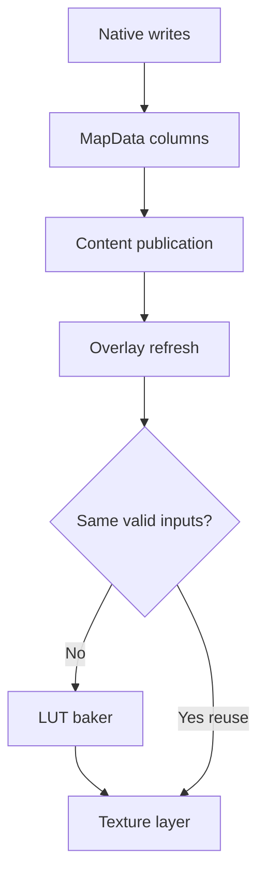

https://github.com/hrhgit/Project.Keynes/pull/77#issuecomment-7152272702

<h3>PR Summary by Qodo</h3>

Skip unchanged elevation and wind overlay rebuilds

<!-- qodo-describe-risk-badge -->
<!-- /qodo-describe-risk-badge -->
<code>✨ Enhancement</code> <code>🧪 Tests</code> <code>📝 Documentation</code> <code>🕐 40+ Minutes</code>


<details>
<summary>AI Description</summary>

<dl>
<dd>
<br/>

><pre>
>• Reuse elevation and wind overlays when their installed inputs match the last successful bake.
>• Rebuild when inputs change or texture, map, or layout validity cannot be confirmed.
>• Add regression coverage and document reduced generation and upload counts.
></pre>

</dd>
</dl>

</details>

<!-- qodo-describe-risk-slot -->

<details>
<summary>Diagram</summary>

<dl>
<dd>

<br/>



</dd>
</dl>

</details>


<details>
<summary>High-Level Assessment</summary>

<dl>
<dd>

<br/>

>The following are alternative approaches to this PR:

<details>
<summary><b>1. Compare complete columns at every refresh</b></summary>

<dl>
<dd>

- ➕ Would detect changes without publisher signatures or storage-identity assumptions.
- ➖ Adds a full-array scan to every due refresh, including unchanged maps.

</dd>
</dl>

</details>

>**Recommendation:** Prefer the PR’s publication-based comparison for this performance goal: it reuses existing validation work for wind and retains the original bake path when evidence is unavailable. Review the storage-identity and signature lifecycle carefully, since an incorrect reuse decision would leave a stale overlay.

</dd>
</dl>

</details>

<details>
<summary> Files changed (20) <code> +633 / -39 </code> </summary>

<dl>
<dd>

<br/>

<details>
<summary>Enhancement (11) <code> +291 / -28 </code></summary>

<dl>
<dd>

<details>
<summary>world_runtime_overlay.gd<code>Reuse valid elevation and wind textures on unchanged inputs</code> <code>+76/-6</code></summary>

<br/>

>Reuse valid elevation and wind textures on unchanged inputs
>
><pre>
>• Tracks inputs from the last successful bake and checks them when a merged refresh is due. Rebuilds on changed or uncertain inputs, map or layout changes, and invalid textures; records the input-check outcome in diagnostics.
></pre>
>
><a href='https://github.com/hrhgit/Project.Keynes/pull/77/files#diff-e6b56d4e13ce2784dd1fe175f742def555fecc2f32231509bf07f7e3a7359f56'>Project/project-keynes/scripts/game/world_runtime_overlay.gd</a>

</details>

<details>
<summary>map_data.gd<code>Version cell index ordering</code> <code>+12/-12</code></summary>

<br/>

>Version cell index ordering
>
><pre>
>• Increments a cell-index revision after synchronous or cooperative index construction so overlays can detect reordered cells even when dimensions are unchanged.
></pre>
>
><a href='https://github.com/hrhgit/Project.Keynes/pull/77/files#diff-040b4c527f4806e025683be94efc39e5fd95f2d37159debd51047bd449aee3ce'>Project/project-keynes/scripts/geography/map_data.gd</a>

</details>

<details>
<summary>data_overlay_layer.gd<code>Expose LUT layout and texture validity</code> <code>+6/-0</code></summary>

<br/>

>Expose LUT layout and texture validity
>
><pre>
>• Versions LUT configuration and adds a check that the expected texture remains bound to the shader. These checks prevent reuse after layout or texture-binding changes.
></pre>
>
><a href='https://github.com/hrhgit/Project.Keynes/pull/77/files#diff-d5eba729e708137162fef87767ef05baf86dbec0e85f78427b3a320a029e5df8'>Project/project-keynes/scripts/rendering/data_overlay_layer.gd</a>

</details>

<details>
<summary>map_overlay_input_publication.cpp<code>Publish comparable native overlay inputs</code> <code>+114/-0</code></summary>

<br/>

>Publish comparable native overlay inputs
>
><pre>
>• Adds a map-attached reader that compares packed-array storage or valid content signatures without scanning every cell at refresh time. Publishes elevation on binding and writeback, and wind when the active layer tracks it.
></pre>
>
><a href='https://github.com/hrhgit/Project.Keynes/pull/77/files#diff-112c0da6e3b8cdeed06c2b7436e033fee12501891a8ef32c797b7865a274d8e8'>gdext/src/map_overlay_input_publication.cpp</a>

</details>

<details>
<summary>map_overlay_input_publication.h<code>Declare overlay input publication hooks</code> <code>+17/-0</code></summary>

<br/>

>Declare overlay input publication hooks
>
><pre>
>• Exposes map binding and elevation/wind publication functions to native writeback paths.
></pre>
>
><a href='https://github.com/hrhgit/Project.Keynes/pull/77/files#diff-66454b00d774d7efe94778d4ac948a78c3cd0f55c064cb23fde56bf940d059c8'>gdext/src/map_overlay_input_publication.h</a>

</details>

<details>
<summary>map_overlay_input_signature.h<code>Define display-only float content signatures</code> <code>+22/-0</code></summary>

<br/>

>Define display-only float content signatures
>
><pre>
>• Adds a two-word signature that mixes float bit patterns in cell order for overlay comparison without entering saves or simulation hashes.
></pre>
>
><a href='https://github.com/hrhgit/Project.Keynes/pull/77/files#diff-b6d884e24c8ada06a9c9854c83e7f00ec3b75c98ae65d6fd14a47ac38ea1c216'>gdext/src/map_overlay_input_signature.h</a>

</details>

<details>
<summary>runtime_climate_kernel.cpp<code>Invalidate wind display signatures on solves</code> <code>+3/-1</code></summary>

<br/>

>Invalidate wind display signatures on solves
>
><pre>
>• Routes completed wind solves through the signature-invalidating method and extends self-test coverage to compare committed wind signatures.
></pre>
>
><a href='https://github.com/hrhgit/Project.Keynes/pull/77/files#diff-21aed376179f8bbcb95e006237abab5ae58649ad16cbe528d3c366caccd54407'>gdext/src/runtime_climate_kernel.cpp</a>

</details>

<details>
<summary>runtime_climate_physics.h<code>Carry optional wind display signatures in physics state</code> <code>+9/-4</code></summary>

<br/>

>Carry optional wind display signatures in physics state
>
><pre>
>• Declares the display-only signature, solve invalidation method, and optional signature collection during validation.
></pre>
>
><a href='https://github.com/hrhgit/Project.Keynes/pull/77/files#diff-5358c23c60651b1106022c3769bc89dde2eb5d20c54003ffbf665150a6e6cb8a'>gdext/src/runtime_climate_physics.h</a>

</details>

<details>
<summary>runtime_climate_physics_state.cpp<code>Compute wind signatures during existing validation</code> <code>+23/-5</code></summary>

<br/>

>Compute wind signatures during existing validation
>
><pre>
>• Mixes final wind direction and speed values while validating physics state, then retains the signature for committed writeback. The signature is copied with committed state but is not written into the serialized physics blob.
></pre>
>
><a href='https://github.com/hrhgit/Project.Keynes/pull/77/files#diff-fda03862fde3de4c1bfb83d3d191dc4729d5852e400b2c34c92c440e5bcf9161'>gdext/src/runtime_climate_physics_state.cpp</a>

</details>

<details>
<summary>world_ext.cpp<code>Register overlay reader and elevation publications</code> <code>+4/-0</code></summary>

<br/>

>Register overlay reader and elevation publications
>
><pre>
>• Binds the native input reader when map data is bound and republishes elevation after whole-column native writeback.
></pre>
>
><a href='https://github.com/hrhgit/Project.Keynes/pull/77/files#diff-6efd49cd6622cbaada71a4656226c1e4b786d14cd1a0dd70fdfff56d0de87fee'>gdext/src/world_ext.cpp</a>

</details>

<details>
<summary>world_ext_simulation_host_climate.cpp<code>Publish wind after complete climate writeback</code> <code>+5/-0</code></summary>

<br/>

>Publish wind after complete climate writeback
>
><pre>
>• Tracks whether all three wind columns were applied and publishes their committed signature after flushing them to MapData. Incomplete or unavailable signature information leaves the overlay on its fallback refresh path.
></pre>
>
><a href='https://github.com/hrhgit/Project.Keynes/pull/77/files#diff-1798025c0177dd314231c2876ce16542cd5867228d37f8747593c2d8a82249fb'>gdext/src/world_ext_simulation_host_climate.cpp</a>

</details>

</dd>
</dl>

</details>

<details>
<summary>Tests (5) <code> +281 / -11 </code></summary>

<dl>
<dd>

<details>
<summary>game_save_roundtrip_test.gd<code>Compare overlays before and after save/load</code> <code>+23/-0</code></summary>

<br/>

>Compare overlays before and after save/load
>
><pre>
>• Captures elevation and wind image bytes and statistics before saving, then checks that freshly opened overlays in the loaded scene match.
></pre>
>
><a href='https://github.com/hrhgit/Project.Keynes/pull/77/files#diff-89966d466d955dbdcb684ee06c53f87b5a9035cda5682f1efd851444dc75dbfd'>Project/project-keynes/tests/game/game_save_roundtrip_test.gd</a>

</details>

<details>
<summary>player_map_overlay_smoke_test.gd<code>Check merged refreshes against the actual deadline</code> <code>+12/-7</code></summary>

<br/>

>Check merged refreshes against the actual deadline
>
><pre>
>• Replaces a fixed wait with a deadline-based check that detects early refreshes and inspects the first due frame after host processing.
></pre>
>
><a href='https://github.com/hrhgit/Project.Keynes/pull/77/files#diff-bc8bdde05aa5a22bb5d8b4ca8f6a987a1f5c07c6139dac124aed12dae606d05c'>Project/project-keynes/tests/game/player_map_overlay_smoke_test.gd</a>

</details>

<details>
<summary>world_runtime_presentation_test.gd<code>Use a typed overlay-layer test double</code> <code>+6/-4</code></summary>

<br/>

>Use a typed overlay-layer test double
>
><pre>
>• Makes the test layer inherit DataOverlayLayer to satisfy the overlay’s typed binding, and frees the layer instances after the comparison.
></pre>
>
><a href='https://github.com/hrhgit/Project.Keynes/pull/77/files#diff-7d2c5f2845e5fb3623512a37330a75088f0ab24f0e0ae69602d0a5ccb92314d2'>Project/project-keynes/tests/game/world_runtime_presentation_test.gd</a>

</details>

<details>
<summary>map_overlay_cell_lut_test.gd<code>Exercise conditional overlay rebuilds</code> <code>+215/-0</code></summary>

<br/>

>Exercise conditional overlay rebuilds
>
><pre>
>• Adds byte-for-byte image and statistics checks across unchanged inputs, edits to each wind component and elevation, layer switches, and resource changes. Also verifies fallback behavior when reliable input information is missing.
></pre>
>
><a href='https://github.com/hrhgit/Project.Keynes/pull/77/files#diff-b23410c11779920d5f84cd97d12f0867aca38572f687b1fb8bb72fcfe5a1aded'>Project/project-keynes/tests/world/map_overlay_cell_lut_test.gd</a>

</details>

<details>
<summary>runtime_climate_physics.cpp<code>Test wind signatures across solves and edits</code> <code>+25/-0</code></summary>

<br/>

>Test wind signatures across solves and edits
>
><pre>
>• Adds self-tests confirming that identical wind values retain their signature across solve days and that changes to any wind input alter it.
></pre>
>
><a href='https://github.com/hrhgit/Project.Keynes/pull/77/files#diff-014a9150997d97b87411e4badb6712c6b322cee2e7a3252894b9a0fda8fef614'>gdext/src/runtime_climate_physics.cpp</a>

</details>

</dd>
</dl>

</details>

<details>
<summary>Documentation (4) <code> +61 / -0 </code></summary>

<dl>
<dd>

<details>
<summary>current-state.md<code>Record conditional overlay refresh behavior</code> <code>+1/-0</code></summary>

<br/>

>Record conditional overlay refresh behavior
>
><pre>
>• Notes that elevation and wind refreshes check installed inputs and that the display session validates shared-texture state and cell order.
></pre>
>
><a href='https://github.com/hrhgit/Project.Keynes/pull/77/files#diff-5d9e4c7595a1bab3498c4e91da1c6dd4804e5b46b94fe83cec9e297bda91f66b'>docs/architecture/current-state.md</a>

</details>

<details>
<summary>feature-guides.md<code>Document overlay input checks and fallback</code> <code>+14/-0</code></summary>

<br/>

>Document overlay input checks and fallback
>
><pre>
>• Explains publication signatures, storage checks, rebuild triggers, and the unchanged refresh rules for other overlays.
></pre>
>
><a href='https://github.com/hrhgit/Project.Keynes/pull/77/files#diff-a08abea9a89fa7d78b407c495fd53f148a38cc7c4bbb76706f1cac9951e2c1f0'>docs/architecture/feature-guides.md</a>

</details>

<details>
<summary>feature-status.md<code>Record overlay measurements and validation limits</code> <code>+41/-0</code></summary>

<br/>

>Record overlay measurements and validation limits
>
><pre>
>• Documents baseline and revised generation/upload counts, focused coverage, and byte-for-byte comparisons. Notes that real-window frame timing and GPU readback remain unverified.
></pre>
>
><a href='https://github.com/hrhgit/Project.Keynes/pull/77/files#diff-8f9ee805cd0fe0164600de34a72a2c5aa6dae7df85f0b51edc3b3d2b3d61a771'>docs/architecture/feature-status.md</a>

</details>

<details>
<summary>module-map.md<code>Locate overlay refresh and publication ownership</code> <code>+5/-0</code></summary>

<br/>

>Locate overlay refresh and publication ownership
>
><pre>
>• Identifies the runtime overlay, native input-publication module, baker, and focused test entry point.
></pre>
>
><a href='https://github.com/hrhgit/Project.Keynes/pull/77/files#diff-36c84d97c3db380f85638d4b7a5203ed40a1027d24e0b72fef2a1045217bc3ab'>docs/architecture/module-map.md</a>

</details>

</dd>
</dl>

</details>

</dd>
</dl>

</details>

<!-- qodo-describe-head:ec9a22ce2ec349504c474fef3099f01c8b79d3c0 -->

<!-- ===== next comment ===== -->

https://github.com/hrhgit/Project.Keynes/pull/77#issuecomment-7152349740

<h3>Code Review by Qodo</h3>

<code>🐞 Bugs (2)</code>  <code>📎 Requirement gaps (2)</code>


<br/>


<details>
<summary>  1.  Overlay savings figures disagree <code>📎 Requirement gap</code></summary>

<br/>

> <details>
><summary>Description</summary>
><br/>
>
><pre>
>The feature-status table reports 50 requests per layer and elevation and wind generations of 10→1
>and 10→6, while the PR body reports 33→35 and 29→38 requests and generations of 9→1 and 9→6 for the
>same 50-day scenario. The PR body&#x27;s before-and-after request counts differ, so those runs did not
>use identical input; their implied savings of 8 and 3 generations conflict with the table&#x27;s 9 and 4,
>leaving readers unable to tell which figures support the claim.
></pre>
></details>

> <details>
><summary>Code</summary>
><br/>
>
><code>[docs/architecture/feature-status.md[R21-24]](https://github.com/hrhgit/Project.Keynes/pull/77/files#diff-8f9ee805cd0fe0164600de34a72a2c5aa6dae7df85f0b51edc3b3d2b3d61a771R21-R24)</code>
>
>```diff
>+| 海拔 | 改前 | 50 | 40 | 0 | 10 | 10 | 10 | 9 |
>+| 海拔 | 审查修正后 | 50 | 40 | 0 | 10 | 1 | 1 | 9 |
>+| 风向 | 改前 | 50 | 40 | 5 | 10 | 10 | 10 | 4 |
>+| 风向 | 审查修正后 | 50 | 40 | 5 | 10 | 6 | 6 | 4 |
>```
></details>

> <details>
><summary>Agent prompt</summary>
><br/>
>
>```
>The issue below was found during a code review. Follow the provided context and guidance below and implement a solution
>
>## Issue description
>The feature-status table and PR body give conflicting request, generation, upload and saved-work figures for the same elevation and wind-direction scenario. The PR body's before-and-after request counts differ, and the cited raw evidence is only under a temporary path.
>
>## Fix Focus Areas
>- docs/architecture/feature-status.md[19-29]
>
>## Recommended Fix
>Re-run the fixed-map fast-forward for both layers using the same input and run identifier for the before-and-after comparison. Update the table and PR body to report one traceable set of request, generation, upload and input-change counts, including the resulting savings; identify any earlier numbers as superseded or remove figures that cannot be traced to a run. Commit the summarized `counts-final-through-50.json` or a portable excerpt under `docs/architecture/evidence/` rather than relying only on a `/private/tmp` path.
>```
> <code>ⓘ Copy this prompt and use it to remediate the issue with your preferred AI generation tools</code>
></details>

[Dismiss ↗](https://app.qodo.ai/findings/8cd50d59-5cb8-4583-bbf7-0f1acc558152?action=dismiss&origin=git) | [View ↗](https://app.qodo.ai/findings/8cd50d59-5cb8-4583-bbf7-0f1acc558152)

<hr/>
</details>


<br/>

<details><summary><ins><strong>View low (3)</strong></ins></summary><br/>


<details>
<summary>  2.  Overlay unit test skips the real refresh wait <code>🐞 Bug</code></summary>

<br/>

> <details>
><summary>Description</summary>
><br/>
>
><pre>
><b><i>_refresh()</i></b> in <b><i>map_overlay_cell_lut_test.gd</i></b> sets the private <b><i>_map_overlay_last_refresh_msec</i></b>
>directly and then subtracts the interval so <b><i>_refresh_map_overlay(false)</i></b> becomes due at once. The
>skip and rebuild counts are therefore checked without the production frame-driven deadline. Only the
>player smoke test covers the real timing, and only for the biology layer.
></pre>
></details>

> <details>
><summary>Code</summary>
><br/>
>
><code>[Project/project-keynes/tests/world/map_overlay_cell_lut_test.gd[R295-300]](https://github.com/hrhgit/Project.Keynes/pull/77/files#diff-b23410c11779920d5f84cd97d12f0867aca38572f687b1fb8bb72fcfe5a1adedR295-R300)</code>
>
>```diff
>+	overlay._map_overlay_last_refresh_msec = Time.get_ticks_msec()
>+	overlay._refresh_map_overlay(false)
>+	_expect(label + " waits for the refresh interval",
>+		overlay._map_overlay_dirty and overlay._map_overlay_refresh_count == before)
>+	overlay._map_overlay_last_refresh_msec -= overlay._map_overlay_refresh_interval_msec()
>+	overlay._refresh_map_overlay(false)
>```
></details>

> <details>
><summary>Agent prompt</summary>
><br/>
>
>```
>The issue below was found during a code review. Follow the provided context and guidance below and implement a solution
>
>## Issue description
>The focused overlay test forces refreshes by writing `_map_overlay_last_refresh_msec`, so the elevation and wind skip paths are never checked under the real refresh interval.
>
>## Fix Focus Areas
>- Project/project-keynes/tests/world/map_overlay_cell_lut_test.gd[292-301]
>- Project/project-keynes/tests/game/player_map_overlay_smoke_test.gd[106-122]
>
>## Recommended Fix
>Keep the fast unit helper. Also add one scenario to the player smoke test that opens elevation or wind, marks the overlay dirty with no input change, waits the real interval the same way the biology case does, and asserts `input_check == "unchanged"` and that `refresh_count` did not increase.
>```
> <code>ⓘ Copy this prompt and use it to remediate the issue with your preferred AI generation tools</code>
></details>

[Dismiss ↗](https://app.qodo.ai/findings/385d029a-6709-4c4b-81d1-737b23c2efa5?action=dismiss&origin=git) | [View ↗](https://app.qodo.ai/findings/385d029a-6709-4c4b-81d1-737b23c2efa5)

<hr/>
</details>


<details>
<summary>  3.  Wind marker cost goes unmeasured <code>📎 Requirement gap</code></summary>

<br/>

> <details>
><summary>Description</summary>
><br/>
>
><pre>
><b><i>validate_values</i></b> now mixes every <b><i>wind_x</i></b>, <b><i>wind_y</i></b> and <b><i>wind_speed</i></b> value of every cell into a
>hash on each daily climate solve, adding three hash updates per cell to the per-day path. The
>feature-status record and the PR body report generation and upload counts only, with no measurement
>of this marker-maintenance cost, so the cost-versus-savings trade-off the ticket asks for cannot be
>judged. Window frame time is also still pending, so the benefit of the cross-publication marker is
>unverified on the production path.
></pre>
></details>

> <details>
><summary>Code</summary>
><br/>
>
><code>[gdext/src/runtime_climate_physics_state.cpp[R60-63]](https://github.com/hrhgit/Project.Keynes/pull/77/files#diff-fda03862fde3de4c1bfb83d3d191dc4729d5852e400b2c34c92c440e5bcf9161R60-R63)</code>
>
>```diff
>+        if (wind_signature) {
>+            wind_signature->add(x);
>+            wind_signature->add(y);
>+            wind_signature->add(speed);
>```
></details>

> <details>
><summary>Agent prompt</summary>
><br/>
>
>```
>The issue below was found during a code review. Follow the provided context and guidance below and implement a solution
>
>## Issue description
>The wind display signature adds three hash updates per cell inside `validate_values` on every daily climate solve. Its maintenance cost is not measured or recorded, so the retention decision required by the ticket is unsupported.
>
>## Fix Focus Areas
>- gdext/src/runtime_climate_physics_state.cpp[60-63]
>- docs/architecture/feature-status.md[42-44]
>
>## Recommended Fix
>Time the signature computation alone on a fixed 60x40 map over a daily-solve sequence, and record the per-solve cost in `feature-status.md` next to the avoided-work counts. If the marker cost is not offset by saved generations and uploads in the window measurement, revert the marker and document the rollback as the ticket requires.
>```
> <code>ⓘ Copy this prompt and use it to remediate the issue with your preferred AI generation tools</code>
></details>

[Dismiss ↗](https://app.qodo.ai/findings/75c480d7-f99c-4ba2-ab13-72afd2e52a0e?action=dismiss&origin=git) | [View ↗](https://app.qodo.ai/findings/75c480d7-f99c-4ba2-ab13-72afd2e52a0e)

<hr/>
</details>


<details>
<summary>  4.  Window frame time for the overlay skip is untested <code>🐞 Bug</code></summary>

<br/>

> <details>
><summary>Description</summary>
><br/>
>
><pre>
>The feature-status entry says the macOS window probe got no draw callbacks, so real frame time and
>GPU readback are not measured. The only evidence for the gain is headless generation and upload
>counts. This is the known factory gap: the PR lists it as pending and does not claim a frame-time
>gain.
></pre>
></details>

> <details>
><summary>Code</summary>
><br/>
>
><code>[docs/architecture/feature-status.md[44]](https://github.com/hrhgit/Project.Keynes/pull/77/files#diff-8f9ee805cd0fe0164600de34a72a2c5aa6dae7df85f0b51edc3b3d2b3d61a771R44-R44)</code>
>
>```diff
>+macOS 窗口探针未能连上图形服务，没有收到绘制回调。实际窗口帧耗时与 GPU 回读待验。
>```
></details>

> <details>
><summary>Agent prompt</summary>
><br/>
>
>```
>The issue below was found during a code review. Follow the provided context and guidance below and implement a solution
>
>## Issue description
>Window frame time for the elevation and wind overlay skip is not measured. Only headless counts exist.
>
>## Fix Focus Areas
>- docs/architecture/feature-status.md[42-45]
>
>## Recommended Fix
>When an unlocked desktop is available, run the same seed, size and 50× speed with each overlay open, before and after, alternating runs. Record the frame P95 in this entry.
>```
> <code>ⓘ Copy this prompt and use it to remediate the issue with your preferred AI generation tools</code>
></details>

[Dismiss ↗](https://app.qodo.ai/findings/bd43fde9-c1e6-4226-93de-8f4ef59d6da6?action=dismiss&origin=git) | [View ↗](https://app.qodo.ai/findings/bd43fde9-c1e6-4226-93de-8f4ef59d6da6)

<hr/>
</details>


</details>


<!-- qodo-self-review-slot -->


<!-- qodo-daily-tip:start -->

<details>
<summary><strong>Tip of the day</strong></summary>

<br/>

<pre>💡 Did you know, you can copy the agent prompt from any finding and feed it to your IDE agent</pre>

<a href="https://docs.qodo.ai/tips-and-tricks">More tips ↗</a> | <a href="https://app.qodo.ai/configurations?tab=display-preferences">Customize Qodo ↗</a> | <a href="https://docs.qodo.ai">Qodo docs ↗</a>

</details>


<!-- qodo-daily-tip:end -->


<!-- https://github.com/hrhgit/Project.Keynes/commit/ec9a22ce2ec349504c474fef3099f01c8b79d3c0 -->

<a href="https://www.qodo.ai"></a>