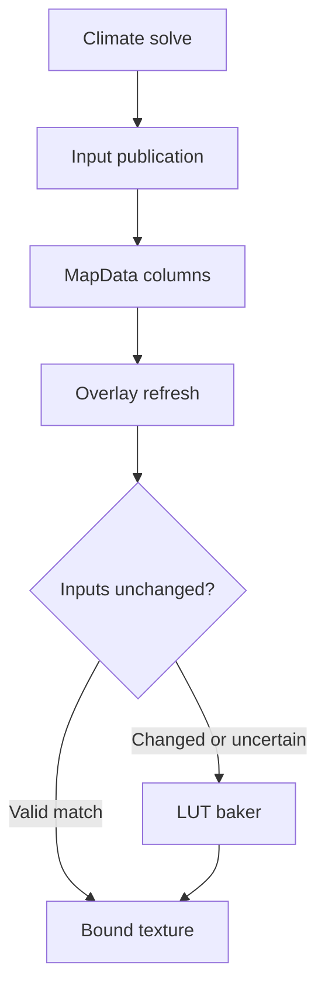

# PR 78 (control, instructions cleared): Qodo comments, saved 2026-11-24

## Comment 7152398148 (2026-11-25T03:57:34Z)

<h3>PR Summary by Qodo</h3>

Skip unchanged elevation and wind overlay rebuilds

<!-- qodo-describe-risk-badge -->
<!-- /qodo-describe-risk-badge -->
<code>✨ Enhancement</code> <code>🧪 Tests</code> <code>📝 Documentation</code> <code>🕐 40+ Minutes</code>


<details>
<summary>AI Description</summary>

<dl>
<dd>
<br/>

><pre>
>• Skip elevation and wind LUT rebuilds when their respective inputs match the last successful bake.
></pre>

</dd>
</dl>

</details>

<!-- qodo-describe-risk-slot -->

<details>
<summary>Diagram</summary>

<dl>
<dd>

<br/>



</dd>
</dl>

</details>


<details>
<summary>High-Level Assessment</summary>

<dl>
<dd>

<br/>

>The following are alternative approaches to this PR:

<details>
<summary><b>1. Compare complete input arrays at each refresh</b></summary>

<dl>
<dd>

- ➕ Keeps change detection within the overlay.
- ➕ Does not require native publication signatures.
- ➖ Adds a full-column comparison on every due refresh.
- ➖ Undermines the goal of avoiding work when inputs are unchanged.

</dd>
</dl>

</details>

>**Recommendation:** Prefer the PR&#x27;s publication-backed comparison: it reuses work already done during native validation and avoids a full scan at refresh time. Its fallback to a full bake when input evidence is unavailable is important for correctness; review should focus on publication invalidation and texture/layout checks.

</dd>
</dl>

</details>

<details>
<summary> Files changed (20) <code> +633 / -39 </code> </summary>

<dl>
<dd>

<br/>

<details>
<summary>Enhancement (11) <code> +291 / -28 </code></summary>

<dl>
<dd>

<details>
<summary>world_runtime_overlay.gd<code>Reuse valid elevation and wind overlay bakes</code> <code>+76/-6</code></summary>

<br/>

>Reuse valid elevation and wind overlay bakes
>
><pre>
>• Compares each active overlay&#x27;s inputs with its last successful bake after the existing refresh interval. Skips baking and uploading only when the input comparison, cell order, LUT layout, image, and bound texture are valid; otherwise it follows the full-bake path and records diagnostic status.
></pre>
>
><a href='https://github.com/hrhgit/Project.Keynes/pull/78/files#diff-e6b56d4e13ce2784dd1fe175f742def555fecc2f32231509bf07f7e3a7359f56'>Project/project-keynes/scripts/game/world_runtime_overlay.gd</a>

</details>

<details>
<summary>map_data.gd<code>Track changes to cell-index ordering</code> <code>+12/-12</code></summary>

<br/>

>Track changes to cell-index ordering
>
><pre>
>• Increments a revision when either index-building path completes, allowing the overlay to reject a cached LUT after cell ordering changes.
></pre>
>
><a href='https://github.com/hrhgit/Project.Keynes/pull/78/files#diff-040b4c527f4806e025683be94efc39e5fd95f2d37159debd51047bd449aee3ce'>Project/project-keynes/scripts/geography/map_data.gd</a>

</details>

<details>
<summary>data_overlay_layer.gd<code>Expose LUT layout and texture validity</code> <code>+6/-0</code></summary>

<br/>

>Expose LUT layout and texture validity
>
><pre>
>• Tracks LUT configuration revisions and provides a check that the shader still has the expected overlay texture bound.
></pre>
>
><a href='https://github.com/hrhgit/Project.Keynes/pull/78/files#diff-d5eba729e708137162fef87767ef05baf86dbec0e85f78427b3a320a029e5df8'>Project/project-keynes/scripts/rendering/data_overlay_layer.gd</a>

</details>

<details>
<summary>map_overlay_input_publication.cpp<code>Publish and compare native overlay inputs</code> <code>+114/-0</code></summary>

<br/>

>Publish and compare native overlay inputs
>
><pre>
>• Registers a MapData input reader that checks backing-array storage and published signatures for elevation or all three wind columns. Publishes elevation on binding or writeback and wind after completed writeback, while treating unavailable evidence as unknown.
></pre>
>
><a href='https://github.com/hrhgit/Project.Keynes/pull/78/files#diff-112c0da6e3b8cdeed06c2b7436e033fee12501891a8ef32c797b7865a274d8e8'>gdext/src/map_overlay_input_publication.cpp</a>

</details>

<details>
<summary>map_overlay_input_publication.h<code>Declare overlay input-publication hooks</code> <code>+17/-0</code></summary>

<br/>

>Declare overlay input-publication hooks
>
><pre>
>• Exposes the reader-binding and elevation and wind publication functions to native map-binding and climate-writeback code.
></pre>
>
><a href='https://github.com/hrhgit/Project.Keynes/pull/78/files#diff-66454b00d774d7efe94778d4ac948a78c3cd0f55c064cb23fde56bf940d059c8'>gdext/src/map_overlay_input_publication.h</a>

</details>

<details>
<summary>map_overlay_input_signature.h<code>Define display-only float signatures</code> <code>+22/-0</code></summary>

<br/>

>Define display-only float signatures
>
><pre>
>• Adds a two-word signature that mixes the bit patterns of published float values in cell order without entering saves or simulation hashes.
></pre>
>
><a href='https://github.com/hrhgit/Project.Keynes/pull/78/files#diff-b6d884e24c8ada06a9c9854c83e7f00ec3b75c98ae65d6fd14a47ac38ea1c216'>gdext/src/map_overlay_input_signature.h</a>

</details>

<details>
<summary>runtime_climate_kernel.cpp<code>Invalidate and verify solved-wind signatures</code> <code>+3/-1</code></summary>

<br/>

>Invalidate and verify solved-wind signatures
>
><pre>
>• Marks a new wind solve through the physics-state helper and extends the climate self-test to compare the restored display signature with its reference.
></pre>
>
><a href='https://github.com/hrhgit/Project.Keynes/pull/78/files#diff-21aed376179f8bbcb95e006237abab5ae58649ad16cbe528d3c366caccd54407'>gdext/src/runtime_climate_kernel.cpp</a>

</details>

<details>
<summary>runtime_climate_physics.h<code>Store an optional wind display signature</code> <code>+9/-4</code></summary>

<br/>

>Store an optional wind display signature
>
><pre>
>• Adds a presentation-only signature to physics state, resets it with state initialization, and allows validation and serialization to produce it.
></pre>
>
><a href='https://github.com/hrhgit/Project.Keynes/pull/78/files#diff-5358c23c60651b1106022c3769bc89dde2eb5d20c54003ffbf665150a6e6cb8a'>gdext/src/runtime_climate_physics.h</a>

</details>

<details>
<summary>runtime_climate_physics_state.cpp<code>Derive signatures during physics validation</code> <code>+23/-5</code></summary>

<br/>

>Derive signatures during physics validation
>
><pre>
>• Invalidates the signature on a wind solve and mixes final corrected wind direction and speed during existing value validation. Copies the resulting signature into committed physics fields.
></pre>
>
><a href='https://github.com/hrhgit/Project.Keynes/pull/78/files#diff-fda03862fde3de4c1bfb83d3d191dc4729d5852e400b2c34c92c440e5bcf9161'>gdext/src/runtime_climate_physics_state.cpp</a>

</details>

<details>
<summary>world_ext.cpp<code>Attach input tracking to native map operations</code> <code>+4/-0</code></summary>

<br/>

>Attach input tracking to native map operations
>
><pre>
>• Binds the overlay input reader when MapData is bound and republishes elevation after native whole-column writeback.
></pre>
>
><a href='https://github.com/hrhgit/Project.Keynes/pull/78/files#diff-6efd49cd6622cbaada71a4656226c1e4b786d14cd1a0dd70fdfff56d0de87fee'>gdext/src/world_ext.cpp</a>

</details>

<details>
<summary>world_ext_simulation_host_climate.cpp<code>Publish wind after complete climate writeback</code> <code>+5/-0</code></summary>

<br/>

>Publish wind after complete climate writeback
>
><pre>
>• Checks whether all three wind columns were applied and publishes their signature after flushing columns to MapData. If a complete trusted publication is unavailable, it invalidates the wind publication instead.
></pre>
>
><a href='https://github.com/hrhgit/Project.Keynes/pull/78/files#diff-1798025c0177dd314231c2876ce16542cd5867228d37f8747593c2d8a82249fb'>gdext/src/world_ext_simulation_host_climate.cpp</a>

</details>

</dd>
</dl>

</details>

<details>
<summary>Tests (5) <code> +281 / -11 </code></summary>

<dl>
<dd>

<details>
<summary>game_save_roundtrip_test.gd<code>Verify overlays after save and load</code> <code>+23/-0</code></summary>

<br/>

>Verify overlays after save and load
>
><pre>
>• Captures elevation and wind images and statistics before saving, then checks their byte-for-byte restoration when opened in the loaded scene.
></pre>
>
><a href='https://github.com/hrhgit/Project.Keynes/pull/78/files#diff-89966d466d955dbdcb684ee06c53f87b5a9035cda5682f1efd851444dc75dbfd'>Project/project-keynes/tests/game/game_save_roundtrip_test.gd</a>

</details>

<details>
<summary>player_map_overlay_smoke_test.gd<code>Wait for the actual overlay refresh deadline</code> <code>+12/-7</code></summary>

<br/>

>Wait for the actual overlay refresh deadline
>
><pre>
>• Replaces a fixed delay with a check around the adaptive refresh deadline and verifies that merged dirty requests do not refresh early.
></pre>
>
><a href='https://github.com/hrhgit/Project.Keynes/pull/78/files#diff-bc8bdde05aa5a22bb5d8b4ca8f6a987a1f5c07c6139dac124aed12dae606d05c'>Project/project-keynes/tests/game/player_map_overlay_smoke_test.gd</a>

</details>

<details>
<summary>world_runtime_presentation_test.gd<code>Use a typed overlay-layer test double</code> <code>+6/-4</code></summary>

<br/>

>Use a typed overlay-layer test double
>
><pre>
>• Makes the layer substitute extend DataOverlayLayer to match the overlay&#x27;s typed binding, while preserving hide-call comparisons and freeing the test nodes.
></pre>
>
><a href='https://github.com/hrhgit/Project.Keynes/pull/78/files#diff-7d2c5f2845e5fb3623512a37330a75088f0ab24f0e0ae69602d0a5ccb92314d2'>Project/project-keynes/tests/game/world_runtime_presentation_test.gd</a>

</details>

<details>
<summary>map_overlay_cell_lut_test.gd<code>Exercise overlay reuse and forced rebuilds</code> <code>+215/-0</code></summary>

<br/>

>Exercise overlay reuse and forced rebuilds
>
><pre>
>• Adds headless checks for unchanged inputs, independent elevation and wind edits, wind speed, coalesced edits, texture loss, layout changes, map replacement, and missing comparison data. Compares regenerated images and statistics with a full-bake reference.
></pre>
>
><a href='https://github.com/hrhgit/Project.Keynes/pull/78/files#diff-b23410c11779920d5f84cd97d12f0867aca38572f687b1fb8bb72fcfe5a1aded'>Project/project-keynes/tests/world/map_overlay_cell_lut_test.gd</a>

</details>

<details>
<summary>runtime_climate_physics.cpp<code>Test wind signatures across solves and edits</code> <code>+25/-0</code></summary>

<br/>

>Test wind signatures across solves and edits
>
><pre>
>• Extends the physics self-test to check that solve-day changes preserve signatures for identical values, each wind lane affects the signature, and restored values recover it.
></pre>
>
><a href='https://github.com/hrhgit/Project.Keynes/pull/78/files#diff-014a9150997d97b87411e4badb6712c6b322cee2e7a3252894b9a0fda8fef614'>gdext/src/runtime_climate_physics.cpp</a>

</details>

</dd>
</dl>

</details>

<details>
<summary>Documentation (4) <code> +61 / -0 </code></summary>

<dl>
<dd>

<details>
<summary>current-state.md<code>Record selective overlay refresh behavior</code> <code>+1/-0</code></summary>

<br/>

>Record selective overlay refresh behavior
>
><pre>
>• Notes that due elevation and wind refreshes inspect installed inputs and validate texture and cell-order state.
></pre>
>
><a href='https://github.com/hrhgit/Project.Keynes/pull/78/files#diff-5d9e4c7595a1bab3498c4e91da1c6dd4804e5b46b94fe83cec9e297bda91f66b'>docs/architecture/current-state.md</a>

</details>

<details>
<summary>feature-guides.md<code>Document overlay input comparison rules</code> <code>+14/-0</code></summary>

<br/>

>Document overlay input comparison rules
>
><pre>
>• Explains the native publication keys, per-overlay inputs, invalidation and fallback behavior, and rebuilds required after display-resource or map changes.
></pre>
>
><a href='https://github.com/hrhgit/Project.Keynes/pull/78/files#diff-a08abea9a89fa7d78b407c495fd53f148a38cc7c4bbb76706f1cac9951e2c1f0'>docs/architecture/feature-guides.md</a>

</details>

<details>
<summary>feature-status.md<code>Record overlay validation and remaining limits</code> <code>+41/-0</code></summary>

<br/>

>Record overlay validation and remaining limits
>
><pre>
>• Documents baseline and post-change headless counts, directed and save/load checks, and the outstanding real-window frame-time and GPU-readback validation.
></pre>
>
><a href='https://github.com/hrhgit/Project.Keynes/pull/78/files#diff-8f9ee805cd0fe0164600de34a72a2c5aa6dae7df85f0b51edc3b3d2b3d61a771'>docs/architecture/feature-status.md</a>

</details>

<details>
<summary>module-map.md<code>Map overlay refresh ownership</code> <code>+5/-0</code></summary>

<br/>

>Map overlay refresh ownership
>
><pre>
>• Identifies the overlay controller, native input-publication module, baker, and directed test entry point.
></pre>
>
><a href='https://github.com/hrhgit/Project.Keynes/pull/78/files#diff-36c84d97c3db380f85638d4b7a5203ed40a1027d24e0b72fef2a1045217bc3ab'>docs/architecture/module-map.md</a>

</details>

</dd>
</dl>

</details>

</dd>
</dl>

</details>

<!-- qodo-describe-head:ec9a22ce2ec349504c474fef3099f01c8b79d3c0 -->

## Comment 7152438406 (2026-11-25T04:00:14Z)

<h3>Code Review by Qodo</h3>

<code>🐞 Bugs (1)</code>  <code>📎 Requirement gaps (1)</code>


<br/>

<details><summary><ins><strong>View low (2)</strong></ins></summary><br/>


<details>
<summary>  1.  Overlay evidence table renders as plain text <code>🐞 Bug</code></summary>

<br/>

> <details>
><summary>Description</summary>
><br/>
>
><pre>
>The delimiter row under the #66 counts table has ten columns, but the header and every data row have
>nine. GitHub-flavored Markdown only treats a block as a table when the delimiter row&#x27;s column count
>matches the header, so the before/after generation and upload counts show up as raw pipe-separated
>text in the architecture docs.
></pre>
></details>

> <details>
><summary>Code</summary>
><br/>
>
><code>[docs/architecture/feature-status.md[R19-21]](https://github.com/hrhgit/Project.Keynes/pull/78/files#diff-8f9ee805cd0fe0164600de34a72a2c5aa6dae7df85f0b51edc3b3d2b3d61a771R19-R21)</code>
>
>```diff
>+| 专题图 | 版本 | 请求 | 合并进待刷新 | 输入变化 | 到期含首次 | 生成 | 上传调用 | 其中重复输入的到期次数 |
>+| --- | --- | ---: | ---: | ---: | ---: | ---: | ---: | ---: | ---: |
>+| 海拔 | 改前 | 50 | 40 | 0 | 10 | 10 | 10 | 9 |
>```
></details>

> <details>
><summary>Agent prompt</summary>
><br/>
>
>```
>The issue below was found during a code review. Follow the provided context and guidance below and implement a solution
>
>## Issue description
>The table in docs/architecture/feature-status.md (#66 section) has a 9-column header but a 10-column delimiter row, so GFM does not render it as a table.
>
>## Fix Focus Areas
>- docs/architecture/feature-status.md[19-24]
>
>## Recommended Fix
>Drop one `---:` cell from the delimiter row on line 20 so it has exactly nine cells, matching the header and data rows.
>```
> <code>ⓘ Copy this prompt and use it to remediate the issue with your preferred AI generation tools</code>
></details>

[Dismiss ↗](https://app.qodo.ai/findings/cb70fad6-b596-4658-bff4-c163c97f7f97?action=dismiss&origin=git) | [View ↗](https://app.qodo.ai/findings/cb70fad6-b596-4658-bff4-c163c97f7f97)

<hr/>
</details>


<details>
<summary>  2.  Wind-overlay frame cost and marker cost are unmeasured <code>📎 Requirement gap</code></summary>

<br/>

> <details>
><summary>Description</summary>
><br/>
>
><pre>
>The wind skip path adds three per-cell hash updates to <b><i>validate_values</i></b> for every wind solve, and
>the PR&#x27;s measurements cover only headless generation and upload counts. The docs record that the
>macOS window probe got no draw callbacks, so alternating 50× window frame time, P95 publication
>frame, and marker-maintenance cost were never measured. Without those numbers, the net benefit of
>the wind marker on the player&#x27;s desktop workload is inferred from counts alone, and a regression in
>frame time would go unnoticed.
></pre>
></details>

> <details>
><summary>Code</summary>
><br/>
>
><code>[docs/architecture/feature-status.md[R42-44]](https://github.com/hrhgit/Project.Keynes/pull/78/files#diff-8f9ee805cd0fe0164600de34a72a2c5aa6dae7df85f0b51edc3b3d2b3d61a771R42-R44)</code>
>
>```diff
>+本轮四组定向检查和正式存读档通过。日志位于同目录的 `verified-focused/` 和 `golden/`。
>+复验用已导入的隔离副本，副本使用系统证书文件以适配当前沙箱。
>+macOS 窗口探针未能连上图形服务，没有收到绘制回调。实际窗口帧耗时与 GPU 回读待验。
>```
></details>

> <details>
><summary>Agent prompt</summary>
><br/>
>
>```
>The issue below was found during a code review. Follow the provided context and guidance below and implement a solution
>
>## Issue description
>The wind-overlay skip adds per-cell signature hashing to the wind solve path and skips wind-image rebuilds. The PR has only headless counts. Window frame time (P95 and mean), skipped encodes, skipped copies and uploads, and marker-maintenance cost are not measured in alternating 50× desktop-window runs.
>
>## Fix Focus Areas
>- gdext/src/runtime_climate_physics_state.cpp[60-63]
>- docs/architecture/feature-status.md[42-44]
>
>## Recommended Fix
>Run alternating 50× desktop-window sessions with the wind skip on and off, using the same quality, camera, and game-day range. Record unchanged and changed publications, actual skipped encodes, skipped copies and uploads, marker cost, and frame P95 and mean. If the marker cost erases the benefit, remove the wind signature path and record the result in feature-status.md.
>```
> <code>ⓘ Copy this prompt and use it to remediate the issue with your preferred AI generation tools</code>
></details>

[Dismiss ↗](https://app.qodo.ai/findings/df332a6e-4fa6-45c3-9ca6-3dca8b5efe76?action=dismiss&origin=git) | [View ↗](https://app.qodo.ai/findings/df332a6e-4fa6-45c3-9ca6-3dca8b5efe76)

<hr/>
</details>


</details>


<!-- qodo-self-review-slot -->


<!-- qodo-daily-tip:start -->

<details>
<summary><strong>Tip of the day</strong></summary>

<br/>

<pre>💡 Did you know, you can copy the agent prompt from any finding and feed it to your IDE agent</pre>

<a href="https://docs.qodo.ai/tips-and-tricks">More tips ↗</a> | <a href="https://app.qodo.ai/configurations?tab=display-preferences">Customize Qodo ↗</a> | <a href="https://docs.qodo.ai">Qodo docs ↗</a>

</details>


<!-- qodo-daily-tip:end -->


<!-- https://github.com/hrhgit/Project.Keynes/commit/ec9a22ce2ec349504c474fef3099f01c8b79d3c0 -->

<a href="https://www.qodo.ai"></a>
