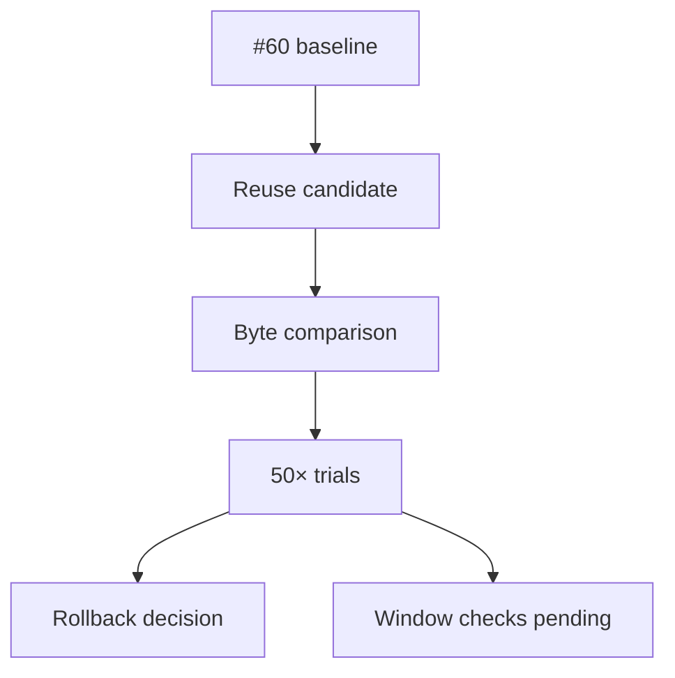

## Comment 7122822173 by qodo-code-review[bot] (2026-11-24T05:18:19Z, updated 2026-11-24T05:18:19Z)

<h3>Code Review by Qodo</h3>
<code>🐞 Bugs (0)</code>  <code>📘 Rule violations (0)</code>  <code>📎 Requirement gaps (0)</code>

<h3>Great, no issues found!</h3>
Qodo reviewed your code and found no material issues that require review

<!-- qodo-daily-tip:start -->

<strong>Tip of the day</strong>

 

<pre>💡 Did you know, you can show, collapse, or hide each part of a finding: code, evidence, and all</pre>

<a href="https://docs.qodo.ai/tips-and-tricks">More tips ↗</a> | <a href="https://app.qodo.ai/configurations?tab=display-preferences">Customize Qodo ↗</a> | <a href="https://docs.qodo.ai">Qodo docs ↗</a>

<!-- qodo-daily-tip:end -->

<!-- https://github.com/hrhgit/Project.Keynes/commit/22ee1086ac1022c5873f5cafd38e932d37fc081c -->

## Comment 7122825371 by qodo-code-review[bot] (2026-11-24T05:18:32Z, updated 2026-11-24T05:20:16Z)

<h3>PR Summary by Qodo</h3>

Document the rolled-back wind-field reuse experiment (#61)

<code>📝 Documentation</code> <code>🕐 10-20 Minutes</code>

AI Description

<dl>
<dd>
 

><pre>
>• Records byte-for-byte checks and 50×-speed measurements of a wind-field reuse candidate.
>• Explains why repeated whole-frame P95 regressions led to its rollback.
>• Identifies rendered-window checks that remain unverified; this PR changes no runtime code.
></pre>

</dd>
</dl>

<!-- qodo-describe-risk-slot --><!-- qodo-describe-risk -->
<!-- qodo-describe-risk-start:1795497512.904747009 -->

Merge Risk <code>🟢 Low</code>

<dl>
<dd>

 

Blast radius <code>🟢 Low</code> <code>💥 0 capabilities</code>

<dl>
<dd>

 

- No production behavior changes identified.

</dd>
</dl>

Behavioral complexity <code>🟢 Low</code> <code>🧩 Assessed behavior</code>

<dl>
<dd>

 

- No production behavior changes identified.

</dd>
</dl>

Potential damage <code>🟢 Low</code> <code>🩹 Assessed behavior</code>

<dl>
<dd>

 

- No production behavior changes identified.

</dd>
</dl>

Assessed commit <a href="https://github.com/hrhgit/Project.Keynes/commit/22ee1086ac1022c5873f5cafd38e932d37fc081c">22ee108</a>

<!-- https://github.com/hrhgit/Project.Keynes/commit/22ee1086ac1022c5873f5cafd38e932d37fc081c -->
</dd>
</dl>

<!-- /qodo-describe-risk -->

Diagram

<dl>
<dd>

 

</dd>
</dl>

High-Level Assessment

<dl>
<dd>

 

>Recording the candidate as withdrawn is appropriate: reduced wind encoding did not justify shipping after repeated headless whole-frame P95 regressions. Retain the baseline until rendered-window measurements and graphics readback can be completed; this documentation-only PR does not implement the proposed optimization.

</dd>
</dl>

 Files changed (1) <code> +55 / -0 </code> 

<dl>
<dd>

 

Documentation (1) <code> +55 / -0 </code>

<dl>
<dd>

feature-status.md<code>Record #61 wind-field reuse results and rollback</code> <code>+55/-0</code>

 

>Record #61 wind-field reuse results and rollback
>
><pre>
>• Adds baseline comparisons, byte-level validation results, and three alternating 50×-speed measurement rounds. Documents the whole-frame P95 regression behind the rollback, points to locally retained evidence, and notes that rendered-window checks remain incomplete.
></pre>
>
><a href='https://github.com/hrhgit/Project.Keynes/pull/69/files#diff-8f9ee805cd0fe0164600de34a72a2c5aa6dae7df85f0b51edc3b3d2b3d61a771'>docs/architecture/feature-status.md</a>

</dd>
</dl>

</dd>
</dl>

<!-- qodo-describe-head:22ee1086ac1022c5873f5cafd38e932d37fc081c -->

## Comment 7122948748 by hrhgit (2026-11-24T05:26:25Z, updated 2026-11-24T05:26:25Z)

### Factory merged PR #69

Qodo completed its review of `22ee1086ac1022c5873f5cafd38e932d37fc081c` with no open blocking findings.

GitHub Actions workflows

- Runtime quick checks — success ([run #45332326674](https://github.com/hrhgit/Project.Keynes/actions/runs/45332326674))

Check runs

- architecture-guards — success ([run #138236157144](https://github.com/hrhgit/Project.Keynes/actions/runs/45332326674/job/138236157144))
- authoring-and-thread-lifetime — success ([run #138236156736](https://github.com/hrhgit/Project.Keynes/actions/runs/45332326674/job/138236156736))

