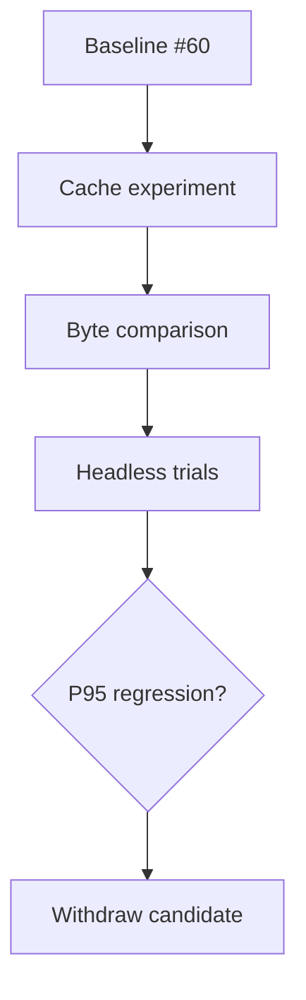

## Comment 7152709101 by qodo-code-review[bot] (2026-11-25T04:17:33Z, updated 2026-11-25T04:21:17Z)

<h3>Code Review by Qodo</h3>
<code>🐞 Bugs (0)</code>  <code>📘 Rule violations (0)</code>  <code>📎 Requirement gaps (0)</code>

<h3>Great, no issues found!</h3>
Qodo reviewed your code and found no material issues that require review

<!-- qodo-daily-tip:start -->

<strong>Tip of the day</strong>

 

<pre>💡 Did you know, you can copy the agent prompt from any finding and feed it to your IDE agent</pre>

<a href="https://docs.qodo.ai/tips-and-tricks">More tips ↗</a> | <a href="https://app.qodo.ai/configurations?tab=display-preferences">Customize Qodo ↗</a> | <a href="https://docs.qodo.ai">Qodo docs ↗</a>

<!-- qodo-daily-tip:end -->

<!-- https://github.com/hrhgit/Project.Keynes/commit/22ee1086ac1022c5873f5cafd38e932d37fc081c -->

## Comment 7152710033 by qodo-code-review[bot] (2026-11-25T04:17:37Z, updated 2026-11-25T04:20:18Z)

<h3>PR Summary by Qodo</h3>

Document withdrawal of the cross-publication wind cache

<code>📝 Documentation</code> <code>🕐 10-20 Minutes</code>

AI Description

<dl>
<dd>
 

><pre>
>• Document byte-for-byte parity and avoided wind encodes in the #61 cache experiment.
>• Report faster weather publication but worse full-frame P95 in headless 50× trials.
>• Record the candidate&#x27;s withdrawal and outstanding real-window graphics validation.
></pre>

</dd>
</dl>

<!-- qodo-describe-risk-slot --><!-- qodo-describe-risk -->
<!-- qodo-describe-risk-start:1795580263.862051964 -->

Merge Risk <code>🟢 Low</code>

<dl>
<dd>

 

Blast radius <code>🟢 Low</code> <code>💥 0 capabilities</code>

<dl>
<dd>

 

- No production behavior changes identified.

</dd>
</dl>

Behavioral complexity <code>🟢 Low</code> <code>🧩 Assessed behavior</code>

<dl>
<dd>

 

- No production behavior changes identified.

</dd>
</dl>

Potential damage <code>🟢 Low</code> <code>🩹 Assessed behavior</code>

<dl>
<dd>

 

- No production behavior changes identified.

</dd>
</dl>

Assessed commit <a href="https://github.com/hrhgit/Project.Keynes/commit/22ee1086ac1022c5873f5cafd38e932d37fc081c">22ee108</a>

<!-- https://github.com/hrhgit/Project.Keynes/commit/22ee1086ac1022c5873f5cafd38e932d37fc081c -->
</dd>
</dl>

<!-- /qodo-describe-risk -->

Diagram

<dl>
<dd>

 

</dd>
</dl>

High-Level Assessment

<dl>
<dd>

 

>Documenting the withdrawn candidate is appropriate: the headless trials show reduced wind-processing work but repeatedly worse full-frame P95. Reintroducing the cache would need further investigation and the outstanding real-window graphics validation; this PR does not ship it.

</dd>
</dl>

 Files changed (1) <code> +55 / -0 </code> 

<dl>
<dd>

 

Documentation (1) <code> +55 / -0 </code>

<dl>
<dd>

feature-status.md<code>Record #61 wind-cache results and withdrawal</code> <code>+55/-0</code>

 

>Record #61 wind-cache results and withdrawal
>
><pre>
>• Adds baseline and byte-parity evidence, alternating 50× headless trial results, and the reason the candidate was withdrawn. It also identifies real-window measurements and graphics readbacks that remain unverified.
></pre>
>
><a href='https://github.com/hrhgit/Project.Keynes/pull/79/files#diff-8f9ee805cd0fe0164600de34a72a2c5aa6dae7df85f0b51edc3b3d2b3d61a771'>docs/architecture/feature-status.md</a>

</dd>
</dl>

</dd>
</dl>

<!-- qodo-describe-head:22ee1086ac1022c5873f5cafd38e932d37fc081c -->

## Comment 7152726859 by hrhgit (2026-11-25T04:18:42Z, updated 2026-11-25T04:18:42Z)

/agentic_review

## Comment 7152750583 by hrhgit (2026-11-25T04:20:15Z, updated 2026-11-25T04:20:15Z)

/agentic_review --review_agent.smart_router_extra_instructions="Review this PR at full depth. Do not skip it as trivial: this documentation records verification results and the decision to withdraw a change."

