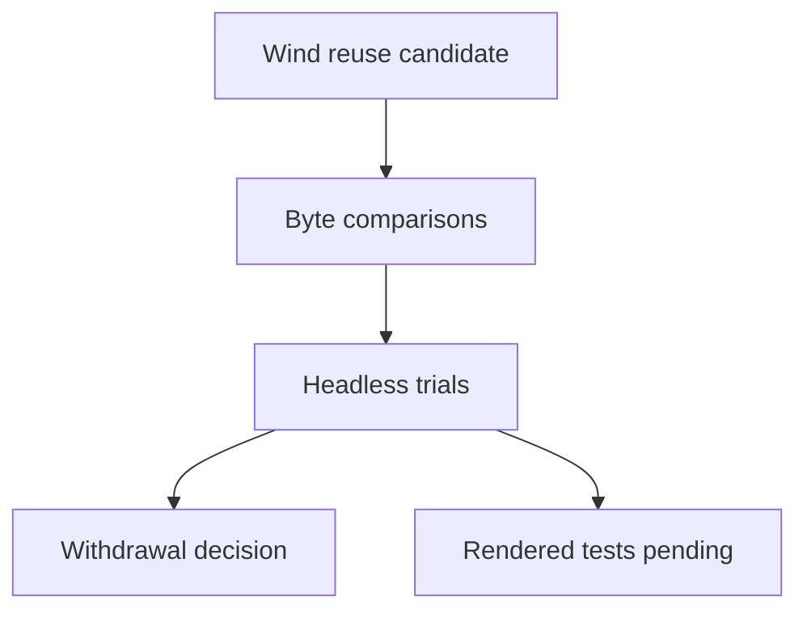

## Comment 7152707651 by qodo-code-review[bot] (2026-11-25T04:17:27Z, updated 2026-11-25T04:21:13Z)

<h3>Code Review by Qodo</h3>

<code>📎 Requirement gaps (1)</code>


<br/>


<details>
<summary>  1.  Speed test table omits sample counts and spread <code>📎 Requirement gap</code></summary>

<br/>

> <details>
><summary>Description</summary>
><br/>
>
><pre>
>The 50× alternating timing table in <b><i>feature-status.md</i></b> reports publish and non-publish counts, copy
>and encode counts, and P95 values for publish frames and all frames, with the window state given as
>headless 64×64. It gives no per-side sample count for the measured intervals and no explicit
>fluctuation or spread measure; those values are only pointed to in <b><i>summary.json</i></b>. A reader checking
>the whole-frame result against the required report (sample count, volatility, window state) cannot
>do so from this page alone, which matters here because the table shows whole-frame P95 rising in all
>three rounds.
></pre>
></details>

> <details>
><summary>Code</summary>
><br/>
>
><code>[docs/architecture/feature-status.md[R35-39]](https://github.com/hrhgit/Project.Keynes/pull/80/files#diff-8f9ee805cd0fe0164600de34a72a2c5aa6dae7df85f0b51edc3b3d2b3d61a771R35-R39)</code>
>
>```diff
>+| 轮次 | 未变/变化发布数（前 → 后） | 实际复制的风数组 | 整图风编码 | 天气表风层上传 | 发布帧 P95（ms） | 全部帧 P95（ms） |
>+| --- | ---: | ---: | ---: | ---: | ---: | ---: |
>+| 1 | 76/11 → 92/11 | 261 → 33 | 87 → 11 | 87 → 22 | 12.45 → 12.29 | 37.38 → 38.20 |
>+| 2 | 87/10 → 73/10 | 291 → 30 | 97 → 10 | 97 → 20 | 13.14 → 9.51 | 35.22 → 42.39 |
>+| 3 | 106/10 → 82/10 | 348 → 30 | 116 → 10 | 116 → 20 | 16.23 → 12.37 | 33.48 → 42.78 |
>```
></details>

> <details>
><summary>Agent prompt</summary>
><br/>
>
>```
>The issue below was found during a code review. Follow the provided context and guidance below and implement a solution
>
>## Issue description
>The 50× alternating timing section in `docs/architecture/feature-status.md` gives publish and non-publish counts, copy/encode/upload counts, publish-frame P95 and all-frame P95 for three rounds. It does not state the sample count per side or a volatility measure in the page itself, so the whole-frame result (which rose in all three rounds) cannot be checked against the required report contents.
>
>## Fix Focus Areas
>- docs/architecture/feature-status.md[35-46]
>
>## Recommended Fix
>In the table or directly below it, add for each round and each side: the number of frames sampled for publish-frame and all-frame P95, and the round-to-round spread of the P95 values. Keep the existing wording that states the window state (无窗口, 64×64) and that whole-frame results are reported only from measurement. Do not change the measured numbers.
>```
> <code>ⓘ Copy this prompt and use it to remediate the issue with your preferred AI generation tools</code>
></details>

[Dismiss ↗](https://app.qodo.ai/findings/af7ad453-81e4-4535-b1a9-72f904d94a98?action=dismiss&origin=git) | [View ↗](https://app.qodo.ai/findings/af7ad453-81e4-4535-b1a9-72f904d94a98)

<hr/>
</details>


<!-- qodo-self-review-slot -->


<!-- qodo-daily-tip:start -->

<details>
<summary><strong>Tip of the day</strong></summary>

<br/>

<pre>💡 Did you know, you can copy the agent prompt from any finding and feed it to your IDE agent</pre>

<a href="https://docs.qodo.ai/tips-and-tricks">More tips ↗</a> | <a href="https://app.qodo.ai/configurations?tab=display-preferences">Customize Qodo ↗</a> | <a href="https://docs.qodo.ai">Qodo docs ↗</a>

</details>


<!-- qodo-daily-tip:end -->


<!-- https://github.com/hrhgit/Project.Keynes/commit/22ee1086ac1022c5873f5cafd38e932d37fc081c -->

<a href="https://www.qodo.ai"></a>

## Comment 7152709846 by qodo-code-review[bot] (2026-11-25T04:17:36Z, updated 2026-11-25T04:19:26Z)

<h3>PR Summary by Qodo</h3>

Document withdrawal of the wind-field reuse candidate


<code>📝 Documentation</code> <code>🕐 10-20 Minutes</code>


<details>
<summary>AI Description</summary>

<dl>
<dd>
<br/>

><pre>
>• Record byte-for-byte validation and 50× headless performance measurements for wind-field reuse.
>• Explain why the candidate was withdrawn despite fewer wind encodes and uploads.
>• Identify rendered-window measurements and graphics readbacks that remain unverified.
></pre>

</dd>
</dl>

</details>

<!-- qodo-describe-risk-slot --><!-- qodo-describe-risk -->
<!-- qodo-describe-risk-start:1795580256.731987953 -->

<details>
<summary>Merge Risk <code>🟢 Low</code></summary>

<dl>
<dd>

<br/>

<details>
<summary>Blast radius <code>🟢 Low</code> <code>💥 0 capabilities</code></summary>

<dl>
<dd>

<br/>

- No production behavior changes identified.


</dd>
</dl>

</details>
<details>
<summary>Behavioral complexity <code>🟢 Low</code> <code>🧩 Assessed behavior</code></summary>

<dl>
<dd>

<br/>

- No production behavior changes identified.


</dd>
</dl>

</details>
<details>
<summary>Potential damage <code>🟢 Low</code> <code>🩹 Assessed behavior</code></summary>

<dl>
<dd>

<br/>

- No production behavior changes identified.


</dd>
</dl>

</details>
<sub>Assessed commit <a href="https://github.com/hrhgit/Project.Keynes/commit/22ee1086ac1022c5873f5cafd38e932d37fc081c">22ee108</a></sub>


<!-- https://github.com/hrhgit/Project.Keynes/commit/22ee1086ac1022c5873f5cafd38e932d37fc081c -->
</dd>
</dl>
</details>
<!-- /qodo-describe-risk -->

<details>
<summary>Diagram</summary>

<dl>
<dd>

<br/>



</dd>
</dl>

</details>


<details>
<summary>High-Level Assessment</summary>

<dl>
<dd>

<br/>

>Recording the withdrawal without shipping the candidate is appropriate given the repeated headless whole-frame regression. Shipping on the strength of reduced encoding work alone would overlook that result; reconsider the optimization only after rendered-window validation.

</dd>
</dl>

</details>

<details>
<summary> Files changed (1) <code> +55 / -0 </code> </summary>

<dl>
<dd>

<br/>

<details>
<summary>Documentation (1) <code> +55 / -0 </code></summary>

<dl>
<dd>

<details>
<summary>feature-status.md<code>Record wind-field reuse results and withdrawal</code> <code>+55/-0</code></summary>

<br/>

>Record wind-field reuse results and withdrawal
>
><pre>
>• Adds a dated entry covering byte-level equivalence checks, skipped wind copies and encodes, and three alternating 50× headless trials. Documents the whole-frame P95 regression behind the withdrawal, locations of retained evidence, and rendered-window checks that could not be completed. No runtime implementation is changed.
></pre>
>
><a href='https://github.com/hrhgit/Project.Keynes/pull/80/files#diff-8f9ee805cd0fe0164600de34a72a2c5aa6dae7df85f0b51edc3b3d2b3d61a771'>docs/architecture/feature-status.md</a>

</details>

</dd>
</dl>

</details>

</dd>
</dl>

</details>

<!-- qodo-describe-head:22ee1086ac1022c5873f5cafd38e932d37fc081c -->

## Comment 7152727152 by hrhgit (2026-11-25T04:18:43Z, updated 2026-11-25T04:18:43Z)

/agentic_review

## Comment 7152750826 by hrhgit (2026-11-25T04:20:16Z, updated 2026-11-25T04:20:16Z)

/agentic_review --review_agent.smart_router_extra_instructions="Review this PR at full depth. Do not skip it as trivial: this documentation records verification results and the decision to withdraw a change."

