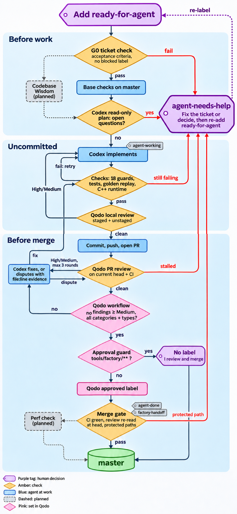
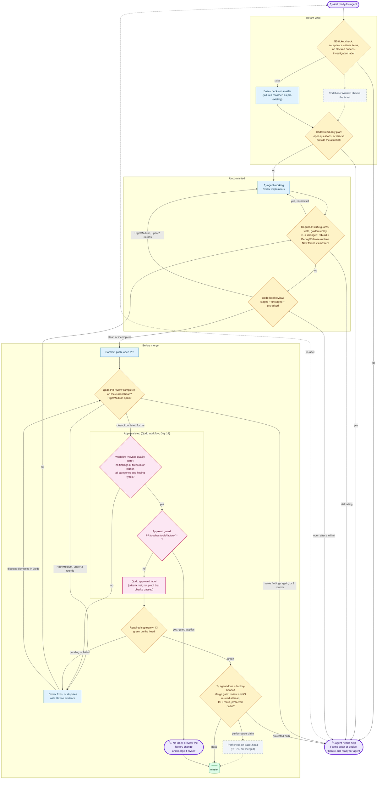

# Ticket to master, with the Day 14 approval step

The Day 10 diagram ([evidence/day10](../day10/factory-diagram.png)) with only the "Before merge" band changed on Day 14. New: the Qodo workflow, the approval guard on `tools/factory/**` and the route to me when it applies. The checks before it (18 static guards, tests, golden replay, C++ runtime, Qodo local review) and CI, the review re-read and the merge gate after it are unchanged and still required; the Qodo approved label does not replace them.

Pink boxes are configured in Qodo, not in the factory's code. The factory's merge gate does not read the label; it re-reads the review, findings and CI itself, so the label and the merge gate check the same review independently.

The image was edited by Codex's image model from the Day 10 image; I checked every label and arrow against the text version below.

## Text version

