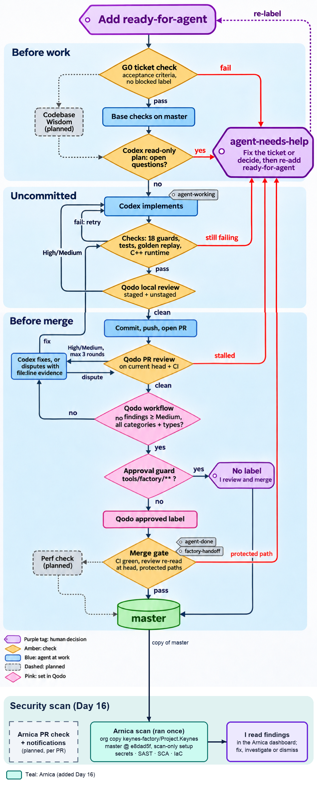
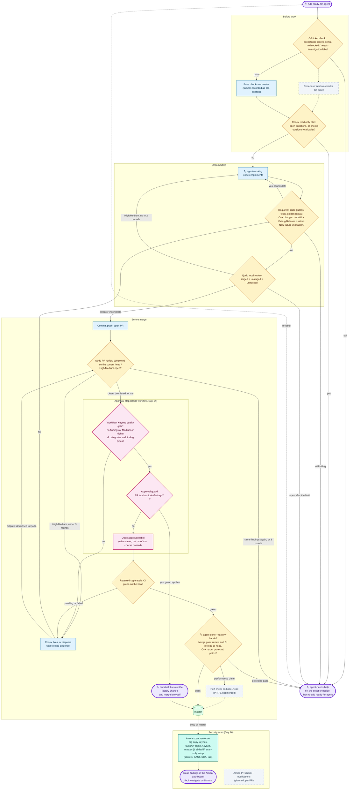

# Ticket to master, with the Day 16 security scan

The Day 10 diagram as updated on Day 14 ([evidence/day14](../day14/factory-diagram.md)), with one band added below `master` on Day 16. Nothing above `master` changed.

- **What ran:** one Arnica scan of `keynes-factory/Project.Keynes`, an organization-owned copy of `hrhgit/Project.Keynes` made because Arnica's GitHub app installs on organizations. Its `master` is the same commit as ours, `e8dad5f`. The integration is in the initial scan-only setup.
- **Where findings are read:** the Arnica dashboard, by me. No Arnica result feeds the factory's gates.
- **Planned, not running:** Arnica PR checks and notifications (no policy enabled).

The band was drawn with `diagram.py` (Pillow) onto the Day 14 image, so every label is typed text.

## Text version

